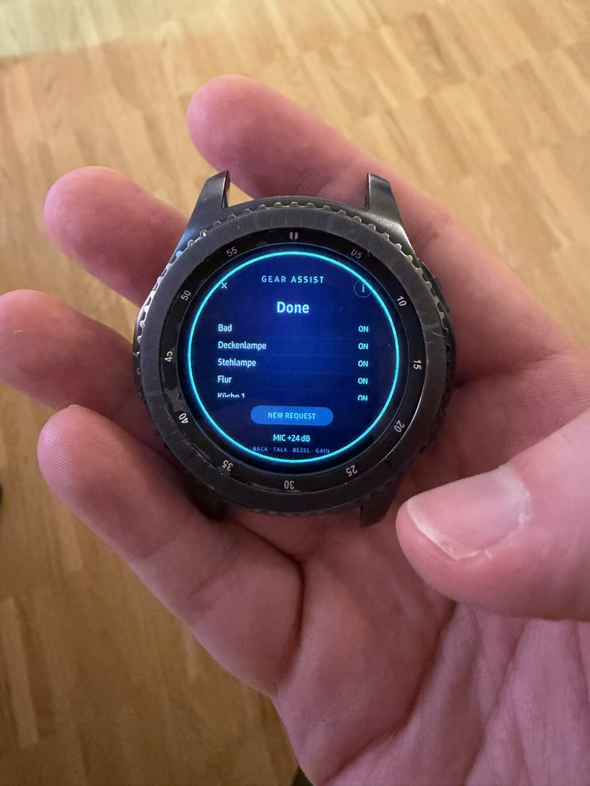
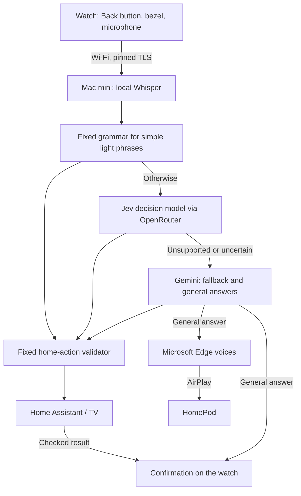
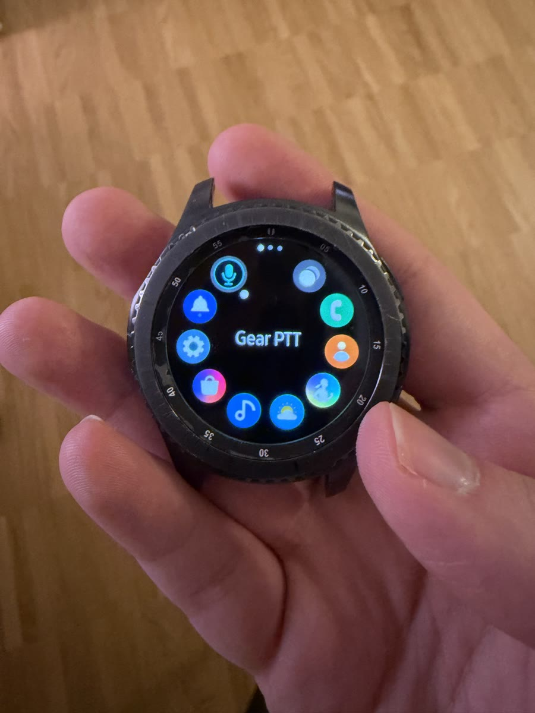

# Gear Assist — a second life for a Samsung Gear S3

<p align="center">
  
</p>

I turned an old Samsung Gear S3 Frontier into a push-to-talk remote for my home. Press **Back**, speak, press again: the watch streams your voice over Wi-Fi to a Mac mini, which transcribes it locally with Whisper, interprets the request and controls lights, the TV or the door lock through Home Assistant. Anything that isn't a home command gets a spoken answer on a HomePod. The watch provides only the microphone, buttons and screen; no AI model runs on it.

**Working prototype on one watch — a source reference, not an installer.**

Built with AI coding agents: implementation and software verification used OpenAI Codex; I performed the physical testing on the watch. See [implementation credits](docs/REFERENCES.md).

https://github.com/user-attachments/assets/2a8b9d1c-7862-4114-89c7-7216f2e55850

## Who this is for

- **Curious about the build:** read the [build story](docs/PROJECT-STORY.md). It covers rooting, signing, permissions and audio on a 2016 Tizen watch.
- **Tizen / old-hardware tinkerers:** the watch client and backend are reusable references for pinned TLS, push-to-talk audio streaming and safe home-action validation.
- **Gear S3 owners hoping to install it:** not possible as-is. It needs a rooted, specially prepared watch and private setup that this repository doesn't provide.

## What it does

- "Turn off all the lights", "Turn off all but the standing light", "Make the standing light green": room groups, single lights, brightness and colour, several commands in one sentence.
- TV on/off, open YouTube or Jellyfin, switch to the PS5.
- Lock the door by voice; unlocking is deliberately impossible.
- Ask anything else and hear the answer on a HomePod.
- German, English and Persian.
- Turn the bezel to adjust microphone gain; short confirmations appear on the watch.

## How it works



Commands take up to three steps: a fixed local grammar for simple light phrases; Jev, a small decision model on OpenRouter, for other supported home commands; and Gemini for everything else. Every home-action plan passes the same fixed validator before anything changes at home, and the door can be locked but never unlocked. Once execution starts, an uncertain result is not retried through another model.

**The watch is rooted:** its early boot was modified for the background-service setup. Root is used for setup and a small boot-time unit that applies the app's trust policy; the audio client itself runs as an ordinary app user (UID 5001) with no extra capabilities. The watch still checks app signatures and the backend's pinned TLS certificate, but its boot chain is no longer stock. See [security](docs/SECURITY.md) and [how it was rooted](docs/PROJECT-STORY.md#4-root-with-a-bounded-ramdisk-change).

Speech recognition runs on the Mac mini; only the text goes to cloud models. Ordinary use needs no phone, just Wi-Fi, the Mac backend and the services you enable. Spoken answers use Microsoft's Edge voices through the unofficial `edge-tts` client.

<p align="center">
  
  <br><sub>Installed on the watch as a normal signed app (launcher name: Gear PTT).</sub>
</p>

## How it was tested

- **Physical tests on one watch** (SM-R760, firmware FVG1, Tizen 4.0.0.7), done by me: Back/bezel controls, voice capture, light/TV/lock commands, on-watch confirmations and spoken HomePod answers.
- **Earlier milestone:** after an intentional reboot the watch services started on their own, and a spoken turn worked with the debug connection (SDB) and temporary setup relay disconnected.
- **Not yet done:** a fresh reboot and long-running test of the complete current stack, which added the v1.2 watch UI and newer backend features after that milestone. SDB-disconnected operation after those additions has not been reverified.
- **Automated:** two Node host tests and 192 Python tests pass locally and in GitHub Actions (one optional TLS test skips without real certificates). They use synthetic inputs and fake services and do not prove real watch, cloud or HomePod behavior. [Details](docs/VERIFICATION.md)

## Try it without a watch

On a Mac with Node.js, Python 3.13, [uv](https://docs.astral.sh/uv/) and ffmpeg, from the repository root:

```sh
node test-core.js
node test-control.js
cd backend
uv venv --python 3.13
uv pip install --python .venv/bin/python -r requirements-tested.txt
.venv/bin/python examples/dry_run.py
.venv/bin/python -m pytest -q -ra
```

The [offline example](backend/examples/dry_run.py) prints a proposed light plan and refuses a door-unlock request, without any network access, speech recognition or AI model. Compare with its [expected output](backend/examples/dry-run-output.json). Test prerequisites are in the [backend notes](backend/README.md#tests).

## What's in the repository, and building your own

Included: the Node 4-compatible watch client, the circular watch UI (v1.2.0), service templates, host tests, and a sanitized Python backend with its tests. The backend uses fictional Home Assistant entity IDs and documentation-only addresses, not my real configuration; the [export changes](docs/SOURCE-EXPORT.md) are listed.

Not included: firmware, Samsung binaries, my signed watch app, certificates, keys, tokens and recordings. There is no installer or rooting recipe. To build your own you need a rooted, specially prepared Gear S3, your own signing and TLS material, a Mac with Whisper and VAD models, cloud model access, and Home Assistant/HomePod for the features you enable. Start with the [watch prerequisites](docs/DEPLOYMENT.md), then the [backend setup](backend/README.md).

## Read next

[Complete build story](docs/PROJECT-STORY.md) · [architecture/protocol](docs/ARCHITECTURE.md) · [backend setup](backend/README.md) · [deployment prerequisites](docs/DEPLOYMENT.md) · [home-control policy](docs/HOME-CONTROL.md) · [speed and TTS decisions](docs/PERFORMANCE.md) · [security](docs/SECURITY.md) · [limits](docs/LIMITATIONS.md) · [third-party dependencies and reuse](THIRD-PARTY.md)

## License

I publish the project-owned code and documentation under the [MIT License](LICENSE), copyright 2026 Sepehr (`sepehrbuilds`). Third-party components retain their own licenses and notices; see [THIRD-PARTY.md](THIRD-PARTY.md) for the dependency and asset boundaries. No model weights, vendor binaries or service access rights are granted by this license.
