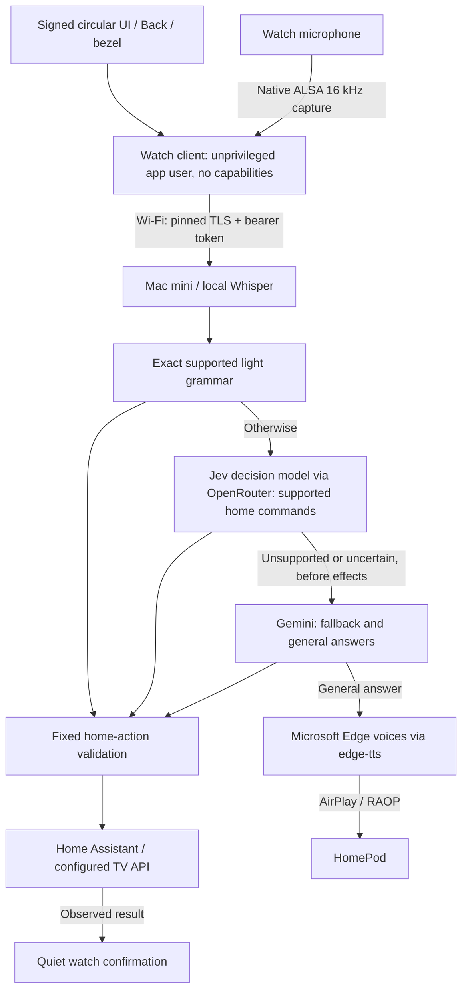

# Gear Assist — a second life for a Samsung Gear S3

I turned an old Samsung Gear S3 Frontier into a push-to-talk remote for my home. Press **Back**, speak, press again: the watch streams your voice over Wi-Fi to a Mac mini, which transcribes it locally with Whisper, interprets the request and controls supported lights, TV functions or the door lock. General questions get spoken answers on a HomePod. The watch supplies the microphone, buttons and screen; it runs no LLM.

**Working prototype on one watch — a source reference, not an installer.**

Built with AI coding agents: implementation and software verification used OpenAI Codex; I performed the physical testing on the watch. See [implementation credits](docs/REFERENCES.md).

## What it does

- Room groups and individual lights, including compound requests in one sentence.
- Brightness, RGB and white temperature on explicitly capable lights. The example bathroom policy is on/off only.
- TV on/off, configured YouTube/Jellyfin app launch and a fixed PS5 HDMI input.
- Door **locking only**: no unlock, open or unlatch action is exposed.
- Short, quiet on-watch confirmations and a connection/status screen. Turn the bezel for microphone gain.
- German, English and Persian interpretation/voices tested; these are not exhaustive language-accuracy certifications.
- General answers through one continuous AirPlay audio session to HomePod, using Microsoft Edge voices via the `edge-tts` library.

## How it was tested

- **Physical tests on one watch** (SM-R760, firmware FVG1, Tizen 4.0.0.7), done by me: Back/bezel controls, voice capture, light/TV/lock commands, on-watch confirmations and spoken HomePod answers.
- **Earlier milestone:** after an intentional reboot the watch services started on their own, and a spoken turn worked with the debug connection (SDB) and temporary setup relay disconnected.
- **Not yet done:** a fresh reboot and long-running test of the complete current stack, which added the v1.2 watch UI and newer backend features after that milestone. SDB-disconnected operation after those additions has not been reverified.
- **Automated:** two Node host tests and 192 Python tests passed (one optional TLS test skipped without real certificates). They use synthetic inputs/fake services and do not prove real watch, cloud or HomePod behavior. GitHub Actions has not run remotely yet. [Details](docs/VERIFICATION.md)

## How it works



Commands take up to three steps: a fixed local grammar for simple light phrases; Jev, a small decision model on OpenRouter, for other supported home commands; and Gemini for fallback and general answers. Every home-action plan passes the same fixed validator before anything changes at home, and the door can be locked but never unlocked. Once action execution starts, an uncertain result is not retried through another model.

**The watch is rooted:** its early boot was modified for the background-service setup. Root is used for setup and a small boot-time unit that applies the app's trust policy; the audio client itself runs as an ordinary app user (UID 5001) with no extra capabilities. The watch still checks app signatures and the backend's pinned TLS certificate, but its boot chain is no longer stock. See [security](docs/SECURITY.md) and [how it was rooted](docs/PROJECT-STORY.md#4-root-with-a-bounded-ramdisk-change).

Speech recognition is local to the Mac mini; selected text goes to cloud models. The deployed configuration uses direct Wi-Fi and does not depend on a phone, SDB or the temporary setup relay for ordinary turns; the later-feature test limits are recorded above. The Mac backend and cloud services must be available, with Home Assistant/TV endpoints and HomePod as appropriate. `edge-tts` is an unofficial client for Microsoft's Edge voices.

## Source included

The current Node 4-compatible watch client, circular UI v1.2.0, service templates, host regression tests, and a sanitized Python backend reference with its tests. The backend export uses fictional HA entity IDs and documentation-only addresses, not my runtime configuration. [Export transformations](docs/SOURCE-EXPORT.md) are explicit.

The watch needs the rooted setup described above, private signing, trust policy and provisioning. Firmware, Samsung binaries, personal WGTs, certificates, keys, tokens and private recordings are not distributed. This is not a one-command installer or a universal rooting recipe.

## Try it without a watch

Start from the repository root on a Mac with Node.js, Python 3.13, [uv](https://docs.astral.sh/uv/) and ffmpeg installed. The host tests run on modern Node (CI uses 22); the deployed watch runtime is the legacy Node 4.4.3. Installing Python dependencies requires internet access; the example and tests use synthetic inputs and local fake services, without cloud keys, model downloads or home-device access.

```sh
node test-core.js
node test-control.js
cd backend
uv venv --python 3.13
uv pip install --python .venv/bin/python -r requirements-tested.txt
.venv/bin/python examples/dry_run.py
.venv/bin/python -m pytest -q -ra
```

The [offline example](backend/examples/dry_run.py) prints a proposed light plan and rejects a forbidden unlock request. It performs no execution, network requests, speech recognition or LLM inference. See its [expected output](backend/examples/dry-run-output.json).

The control test needs free loopback port 8765; Python tests use temporary loopback listeners and synthetic child processes. Run the macOS backend suite on macOS because ASR process ownership checks use `/usr/sbin/lsof`. ffmpeg enables the MP3 decoder fixture. The optional real-certificate TLS test needs explicitly supplied certificate paths.

## Build your own setup

Use the [prepared-watch prerequisites](docs/DEPLOYMENT.md) first, then the [backend setup](backend/README.md). You need a rooted, specifically prepared Gear S3; private signing/provisioning and TLS material; a Mac with compatible Whisper/VAD assets; cloud model access; and Home Assistant/HomePod for the features you enable. `ha_enabled` is false in the example, and TV app/source placeholders need deliberate private configuration.

The repository is a source reference for a one-watch prototype. It includes neither a stock-watch installer nor the vendor binaries and personal credentials needed to reproduce my deployment.

## Read next

[Complete build story](docs/PROJECT-STORY.md) · [architecture/protocol](docs/ARCHITECTURE.md) · [backend setup](backend/README.md) · [deployment prerequisites](docs/DEPLOYMENT.md) · [home-control policy](docs/HOME-CONTROL.md) · [speed and TTS decisions](docs/PERFORMANCE.md) · [security](docs/SECURITY.md) · [limits](docs/LIMITATIONS.md) · [third-party dependencies and reuse](THIRD-PARTY.md)

## License

I publish the project-owned code and documentation under the [MIT License](LICENSE), copyright 2026 Sepehr (`sepehrbuilds`). Third-party components retain their own licenses and notices; see [THIRD-PARTY.md](THIRD-PARTY.md) for the dependency and asset boundaries. No model weights, vendor binaries or service access rights are granted by this license.
